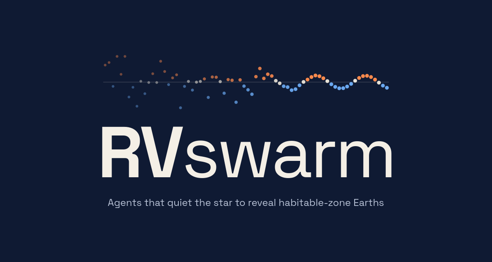

<p align="center">
  
</p>

# RV-Swarm

A swarm of Claude agents that proposes, debates, implements and evaluates algorithms
for removing stellar-activity signals from NEID Sun-as-a-star radial velocities, with
the goal of several independent methods below 20 cm/s RMS per epoch that provably leave
planetary signals intact.

The project runs three fully independent swarms, each on its own curated set of about
500 spectra (RUNBOOK section 3.5), with a combined API budget of 200 000 USD over six
months (RUNBOOK section 11).

**Start with [`RUNBOOK.md`](RUNBOOK.md).** It covers setup, validation, running,
monitoring, steering and the integrity design.

Quick orientation:

```
config/      harness.yaml  swarm.yaml  cluster.env        <- the three files you edit
harness/     data API, blind injection, audit, scoring, promotion   (agents cannot see this)
bin/         submit_eval.sh  submit_ingest.sh  eval_job.sbatch      (SLURM entry points)
baselines/   reference algorithms and canary cheaters
swarm/       the orchestrator that makes the Claude API calls
workspace/   everything agents read and write: literature, proposals, specs, code,
             results, post-mortems, registry, digests, your suggestions
tests/       selftest.sh  (harness check on synthetic data; no key or data needed)
```

Shortest path to a first run:

```bash
tests/selftest.sh                                 # 1. harness sanity
$EDITOR config/cluster.env                        # 2. data path, python, SLURM account, sandbox
bin/submit_ingest.sh                              # 3. build the data store (cluster)
bin/swarm.sh init              # 4. queue baselines + canaries
bin/submit_eval.sh                                # 5. evaluate them; check RUNBOOK section 5
export ANTHROPIC_API_KEY=...                      # 6. start the swarm
bin/swarm.sh loop
```

## Acknowledgement

The code and documentation in this repository were implemented with Claude Fable 5.2
(Anthropic), working in Claude Code under the direction of the project scientists. The
agents of the swarm also run on Claude models through the Anthropic API.
